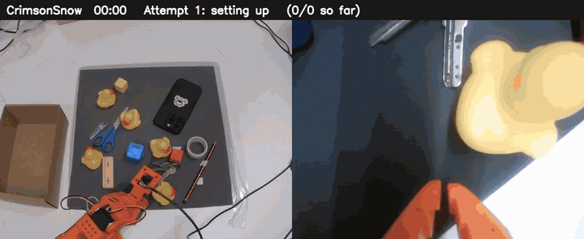
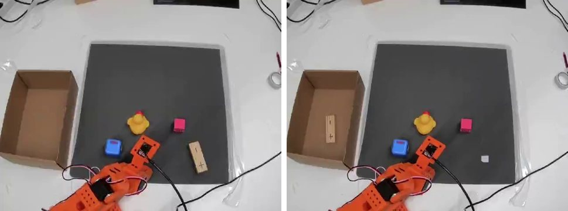
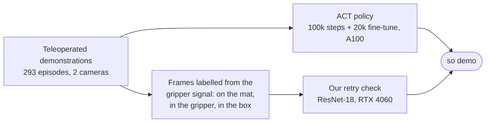
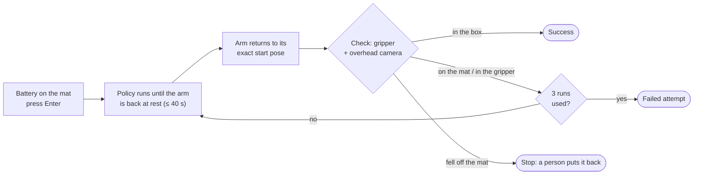
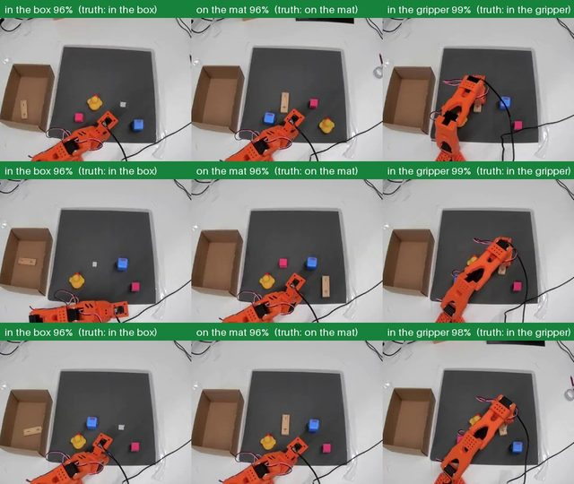
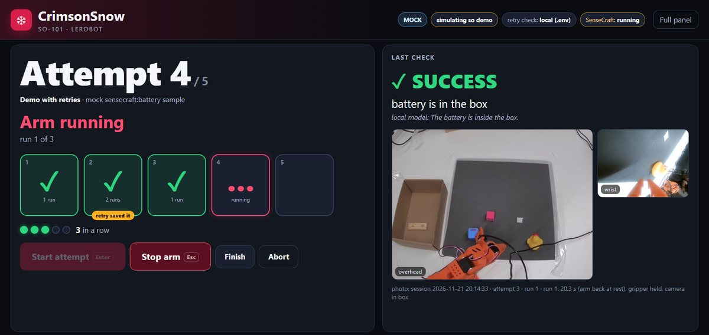

<div align="center">

# CrimsonSnow · SO-101 battery picker

**An SO-101 arm that learned from 293 demonstrations to pick the battery out of a cluttered
mat, drop it in the box, and notice by itself when it failed.**

Team CrimsonSnow · Hackathon LeRobot Bilbao (II edition, 20–22 Nov 2026) · LeRobot 0.7.0 · ACT

[](https://github.com/SO-101-Hackathon/CrimsonSnow/actions/workflows/ci.yml)


<a href="docs/presentation/video/clutter_test_2x.mp4"></a>

*Real run at 2× speed: the battery among 14 other objects, picked and dropped in the box on the first try
(overhead camera left, wrist camera right; [video](docs/presentation/video/clutter_test_2x.mp4)).*

</div>

## What it does

A wooden "battery" (marked + and −) lies on a mat among other objects: a rubber duck, a toy car, a
pink TNT cube and, in later recordings, a yellow cube, a tape roll and a pen. The arm has to pick the
battery, and only the battery, and drop it in the cardboard box. Batteries that end up in the wrong
bin start fires in waste trucks and sorting plants; picking them out of mixed items is a real sorting
job, and here a hobby-grade arm learns it from demonstrations.

<p align="center"></p>

What makes the demo different: **it checks its own work.** After each run the arm returns to its start
pose, a camera check decides where the battery is, and if it is still on the mat the policy simply runs
again: no one touches the robot. The check can be our own vision model (trained on our recordings,
offline), ChatGPT or Claude, chosen with one line in `.env`.

| | |
|---|---|
| Robot | SO-101 leader + follower (6 axes each), overhead camera + wrist camera, 640×480 @ 30 fps |
| Data | **293 teleoperated episodes, 193,638 frames (≈ 108 min)**: 108 balanced arrangements, 149 aimed at the failures we found, 24 on the weakest spots, 12 along the whole arc |
| Policy | **ACT** (51.6 M parameters). First model: 100,000 steps on an RTX 5090 (SenseCraft's cloud). Final models: **100,000 steps from scratch on an A100** (Hugging Face Jobs, 1 h 57 min), then **fine-tuned 20,000 steps** with the 12 arc episodes |
| Models | [act_battery_full_100k](https://huggingface.co/CrimsonSnowLLC/act_battery_full_100k) · [fine-tuned for every location](https://huggingface.co/CrimsonSnowLLC/act_battery_finetune_locations_2026-11-22_03-35-47) (public, with model cards) |
| Results | first model **3/7** by hand → **24/24** orders of the objects on the 4 taped places → final model **9 of 11** logged attempts in the box on the first run, one of them on a cluttered mat ([journal/demo.csv](journal/demo.csv)) |
| Retry check | our own ResNet-18, trained in 8 minutes on the laptop's RTX 4060 from 4,000 frames labelled automatically: **99.8 % right on 50 episodes it never saw, never a wrong "in the box", 10 ms per photo, offline** ([report](journal/vision-report.md)) |
| Datasets | [battery-full-dataset](https://huggingface.co/datasets/CrimsonSnowLLC/battery-full-dataset) (281 episodes) · [battery-full-plus-locations](https://huggingface.co/datasets/CrimsonSnowLLC/battery-full-plus-locations) (+12 along the arc), public on Hugging Face in LeRobot format |
| Pitch | [docs/presentation/](docs/presentation/): 9 slides with speaker notes and two videos of real runs, 4:30 of talk, plus a bonus slide |

## How it works



One demo attempt, with nobody touching the robot:



Every attempt is logged in [journal/demo.csv](journal/demo.csv); the photos the check looked at are
kept in `outputs/demo/`.

## What we did and why

1. **First dataset, first model.** 108 episodes in a balanced order of object arrangements
   ([docs/strategy/](docs/strategy/)), recorded and trained (ACT, 40k steps) in SenseCraft Robotics.
2. **Found the failure points.** `so try` runs the policy attempt by attempt and logs a verdict with a
   note: 3 successes in 7. Failures: a battery turned on the mat got no attempt at all, grabs too low or at
   the very top got stuck, and any change of position hurt.
3. **Recorded against those failures without forgetting the old skill.** 149 new episodes: each setup
   recorded straight, turned 20° left and right, and moved 2 cm towards and away from the arm, while
   straight placements stay at about 80 % of all data (the plan and the recording sheet are web pages
   in [docs/strategy/](docs/strategy/): `fix-plan.html` and `recordings.html`, open them in a browser).
4. **Retrained on everything:** 257 episodes, ACT, 100,000 steps on an RTX 5090 (SenseCraft's cloud).
   Every order of the four objects over the four taped places worked (24/24), 34 runs on the team's test
   pages without a failure, and the battery came out of a pile of 14 other objects on the first try.
5. **Closed the loop.** In the first retry tests with the old model, 3 of the 4 successful attempts
   only succeeded on the second or third run, and a gripper-only check once called a run a success
   while the battery was still in the gripper. Hence a camera check, and then our own model for it,
   so the demo needs no internet and no API key.
6. **The weakest places, then the gaps.** 24 more episodes on taped places 2 and 3, and all 281 retrained
   from scratch on Hugging Face Jobs (ACT, 100,000 steps, batch 8, one A100, 1 h 57 min). That model missed
   only in two gaps between the taped places, where nobody had recorded, so we recorded 12 episodes along
   the whole arc ([docs/strategy/arc.html](docs/strategy/arc.html)) and fine-tuned it for 20,000 more steps,
   the 12 counted twice so they weigh about 9 % (about 25 min on an A100).
7. **Final model:** 9 of 11 logged attempts in the box on the first run, the other two on the second
   ([journal/demo.csv](journal/demo.csv), 22 Nov 05:04–05:23). Four of them, filmed by
   `so demo --record-video`, are on slide 7 of the deck
   ([video](docs/presentation/video/final_model_3x.mp4), 3× speed).

## Our own retry check (`so vision`)

The check has one question to answer: is the battery in the box, still on the mat, or still in the
gripper? We trained a small vision model for exactly that, from our own recordings:

- **Labels for free.** Every recording starts with the battery on the mat and ends with it in the box,
  and the gripper position is saved with every frame. Before the grab = *on the mat*, while the gripper
  holds something = *in the gripper*, after it opens over the box = *in the box*. 250 of 257 episodes
  were labelled this way; 16 frames each, 4,000 frames in 46 seconds.
- **Model.** ResNet-18 (ImageNet weights) fine-tuned on the overhead picture at 448×336, with
  changes of light, small camera shifts and blur, on the laptop's RTX 4060.
- **Honest test.** Every fifth episode is never trained on. It only says *in the box* when at least
  80 % sure (a wrong *in the box* would end a failed attempt), otherwise the demo falls back to the
  gripper reading.

| Test | Result |
|---|---|
| 800 frames from 50 episodes it never saw | **99.8 %** right (100 % with the arm at rest, as the demo sees it) |
| Wrong *in the box* (a failure counted as success) | **0** |
| Real check photos from our first `so demo` runs, no hands in view | **10 / 10**, including a battery still in the gripper that a gripper-only check had called a success |
| Real photos with a person's hand in view (never in the training data) | 7 / 8, the other one *unsure* |
| Time per photo | **10 ms** on the RTX 4060 (ChatGPT / Claude: 1–3 s and an internet connection) |



```bash
so vision prepare      # copy the dataset (SenseCraft's is only read) and cut the labelled frames
so vision train        # 8 min on an RTX 4060
so vision test         # writes journal/vision-report.md
so demo --check local  # or RETRY_CHECK=local in .env
```

### Choosing the check

Copy [.env.example](.env.example) to `.env` (git-ignored) and set one line:

```ini
RETRY_CHECK=local      # local (our model, offline) | openai (ChatGPT) | claude | grip | auto
```

`openai` and `claude` need their key in the same file (`OPENAI_API_KEY`, `ANTHROPIC_API_KEY`).
`so demo --check <word>` overrides the file for one session.

## Control panel for the demo (`so panel`)



`so panel` opens a local web page (http://127.0.0.1:8765) for running the demo in front of an audience:

- choose the model (SenseCraft's or one of ours) and the check, then start the demo with retries, manual
  trials, teleoperation, the camera test or the self-check;
- one big button for whatever comes next: **Start attempt** (Enter), **Stop arm** (Esc), **Finish**, and
  S / F / X to mark manual trials;
- the scoreboard (attempt tiles, "retry saved it", the streak towards five in a row), the photo the check
  looked at with its verdict, the live log, and the results per model from the journal;
- a **jury view** with only the score and the last check (J key, or `/#jury`);
- a **Record the full test on video** switch: the whole session from the robot's own overhead and wrist
  cameras, with each attempt and verdict written on top, saved as `outputs/demo/<session>/test.mp4`
  (`so demo --record-video` does the same from the terminal).

It runs the same `so` commands in the background, one at a time, answers only this computer unless
started with `--host 0.0.0.0` (the printed link then carries an access token), needs nothing beyond
Python, and refuses robot commands while SenseCraft holds the arm. **Finish** is the gentle stop (the
arm returns to its start pose); Abort ends the process. `so panel --mock` simulates whole sessions
without the robot, for rehearsing; the picture above is from mock mode.

## Install

You need an SO-101 leader/follower pair, two USB cameras and a computer with Python 3.12. Training wants
an NVIDIA GPU (or Apple MPS for short tests, or a cloud GPU).

**Ubuntu, macOS, WSL**

```bash
git clone https://github.com/SO-101-Hackathon/CrimsonSnow.git
cd CrimsonSnow
./setup.sh                 # Miniforge if missing + conda env "lerobot" (py3.12) + ffmpeg + lerobot==0.7.0 + `so`
conda activate lerobot
hf auth login              # token needs WRITE access: https://huggingface.co/settings/tokens
so doctor                  # checks GPU, ffmpeg, login, ports, cameras, and says how to fix what is missing
```

**Windows 11, native**

```powershell
# In a Miniforge Prompt, inside this folder
conda create -y -n lerobot -c conda-forge python=3.12 ffmpeg
conda activate lerobot
pip install torch==2.15.0 torchvision --index-url https://download.pytorch.org/whl/cu132
pip install "lerobot[core_scripts,training,feetech]==0.7.0"
pip install -e . --no-deps
powershell -ExecutionPolicy Bypass -File .\admin-setup.ps1    # once: Windows Developer Mode
so doctor
```

[docs/SETUP.md](docs/SETUP.md) explains every step and what differs between systems;
[docs/SETUP_LOG.md](docs/SETUP_LOG.md) records what we set up when. Installing, the scripts and the
`so` helper are checked on Ubuntu, macOS and Windows on every push.

Safety: each arm has its **own** power supply, often at different voltages (e.g. leader 5 V, follower
12 V). Label them and never swap them. Commands that move the arm need a person at the robot.

## Workflow

Two equivalent ways to run the official `lerobot-*` commands: bash scripts configured by `robot.env`
(macOS, Linux, WSL) and the `so` helper configured by [hackathon.toml](hackathon.toml) (every system,
including native Windows). Both use the same arm ids, camera names, resolution and task text, and
`tests/` fails if they drift apart.

| Step | Bash scripts | `so` helper |
|---|---|---|
| Calibrate (once per arm) | `scripts/calibrate.sh follower` / `leader` | `so calibrate follower` / `leader` |
| Teleoperate | `scripts/teleop.sh` | `so teleop` |
| Record a dataset / add episodes | `scripts/record.sh 60` / `scripts/resume_record.sh <dataset> 10` | `so record` / `so record --resume -n 10` |
| Check dataset quality | | `so qa` |
| Train ACT | `scripts/train.sh <dataset> 20000` | `so train --steps 20000` |
| Run the policy | `scripts/rollout.sh 60` | `so rollout` |
| Find failure points (you mark each run s/f) | | `so try` (or `so try --sensecraft`) |
| Demo with automatic retries | | `so demo` (or `so demo --sensecraft`) |
| Train / test our retry check | | `so vision prepare`, `train`, `test` |
| Demo control panel | | `so panel` |
| Compare models from the logs | | `so eval --summary` |

`so show` prints the plain `lerobot-*` commands for the current configuration, `so <command> --help`
lists the options and `--dry-run` shows a command without running it. Every command run through `so`
is appended to [journal/commands.md](journal/commands.md).

Models trained in **SenseCraft Robotics** use SenseCraft's arm calibration and camera names:
`so demo --sensecraft` and `so try --sensecraft` handle both. Close SenseCraft first; it keeps the
arms' ports and the cameras open.

## Evidence

| File | What it shows |
|---|---|
| [journal/commands.md](journal/commands.md) | every command we ran through `so`, in order |
| [journal/eval.csv](journal/eval.csv) | manual trials (`so try`): verdict and note per run |
| [journal/demo.csv](journal/demo.csv) | demo attempts with retries: every run, the check's answer, the decision |
| [journal/vision-report.md](journal/vision-report.md) | how well our retry check does on unseen episodes and real photos |
| [docs/presentation/video/](docs/presentation/video/) | real runs filmed by `so demo --record-video`: the clutter test (2×) and the final model (3×) |
| [Hugging Face: CrimsonSnowLLC](https://huggingface.co/CrimsonSnowLLC) | the datasets and the two final models, with cards that say how each was made |
| [docs/SETUP_LOG.md](docs/SETUP_LOG.md) | what was installed and decided, when |
| [docs/strategy/](docs/strategy/) | recording plans and checklists |

## Repository layout

```
sokit/                the `so` helper: wrappers around lerobot-*, QA, eval log, demo with retries,
                      vision.py (our retry check), panel.py + panel.html (demo control panel)
scripts/              bash wrappers around the official lerobot-* commands (macOS, Linux, WSL)
hackathon.toml        settings for `so`: arm ids, cameras, task, record/train/rollout options
robot.env.example     settings for scripts/*.sh (copy to robot.env)
.env.example          which retry check to use, and API keys (copy to .env, never committed)
tests/                checks that run without a robot, on every operating system (CI)
docs/                 SETUP.md, SETUP_LOG.md, strategy/ (recording plans), presentation/ (pitch deck)
journal/              the evidence: commands, trials, demo attempts, vision report
calibration/          arm calibration files and reference camera frames
requirements/         exact package versions of the Windows environment our numbers come from
setup.sh              one-time setup on Ubuntu, macOS and WSL
admin-setup.ps1       one-time Windows setup that needs admin (Developer Mode)
RUNBOOK.md            the weekend playbook for the team's Windows laptop
```

## Acknowledgements

Built with [LeRobot](https://github.com/huggingface/lerobot) (Hugging Face) on the
[SO-101](https://github.com/TheRobotStudio/SO-ARM100) arm by TheRobotStudio, with
[SenseCraft Robotics](https://www.seeedstudio.com/) by Seeed Studio for recording and cloud training, at
the Hackathon LeRobot Bilbao (II edition, 20–22 November 2026) organised with Bravo Robots, following the
[official guide](https://hackathonbilbao.eus/guia-so-101).

Links: [LeRobot docs](https://huggingface.co/docs/lerobot) · [SO-101](https://huggingface.co/docs/lerobot/so101) · [IL on real robots](https://huggingface.co/docs/lerobot/il_robots)
